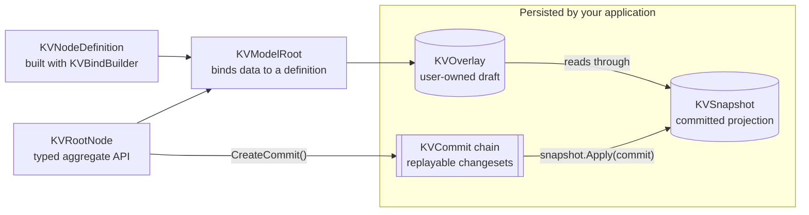

# Mental model

Think of each KVBind aggregate as a small Git repository for an object graph.

A root object has committed state, draft state and a history of changes. You edit through typed C# properties or patch operations, inspect what changed, commit the draft, discard parts of it, and replay commits to reconstruct state at any point in time.

KVBind is also close to event sourcing for UI edits: it records user-intended changes over large forms or object graphs, while maintaining an effective current projection for ordinary typed reads.

## The runtime model



| Type | Git analogy | Role |
| --- | --- | --- |
| `KVSnapshot` | the checked-out tree at `HEAD` | Committed projection of canonical path/value data, stamped with `LastCommitId` and `SchemaVersion`. |
| `KVOverlay` | uncommitted changes | A user-owned draft over a snapshot. Reads fall through to the snapshot; writes stay in the overlay. |
| `KVCommit` | a commit | An immutable, replayable changeset with `PreviousCommitId`, user and timestamp. |
| `KVModelRoot` | — | Binds snapshot and overlay data to a runtime definition. |
| `KVRootNode` | — | The typed aggregate root your code works with. |

A typical edit/commit flow:

```csharp
var overlay = KVOverlay.Create(snapshot, user: "alice");
var agreement = KVRootNode.Create<Agreement>(overlay, definition);

agreement.Title = "Updated agreement";

var draftChanges = agreement.GetAllChanges();
var commit = agreement.CreateCommit(DateTimeOffset.UtcNow);

snapshot.Apply(commit);
```

Applications own persistence of snapshots, overlays and commits. A snapshot can always be rebuilt by applying its commit chain to an empty snapshot, and an overlay can be stored as just its changes plus the id of the commit it is based on.

## Canonical storage, flexible layout

KVBind stores values by **canonical path** (for example `General/Code` or `LineItems/shipping/Amount`) instead of serializing the current C# object graph shape. Typed nodes, field groups, sections and UI layouts can therefore evolve without forcing a data migration.

- Keys are case-sensitive and may only contain `A-Z`, `a-z`, `0-9` and `_`.
- Collection item ids form a path segment of their own (`Animals/Snake`).
- Polymorphic nodes store their subtype as a `$type` token next to their data.

When a change *does* need to transform stored data — a backfill, a rename, a removal or a nested-type swap — [schema migrations](/workflows/migrations) handle it as ordinary commits.

## Creating versus binding

There are two ways to get a typed root over an overlay:

- `KVRootNode.CreateNew<T>(...)` creates a **new** aggregate and applies the definition's defaults across it.
- `KVRootNode.Create<T>(...)` **binds an existing** aggregate and never applies defaults, so stored data is never overwritten.

See [Defaults and reset](/dsl/defaults-and-reset) for when defaults apply.
