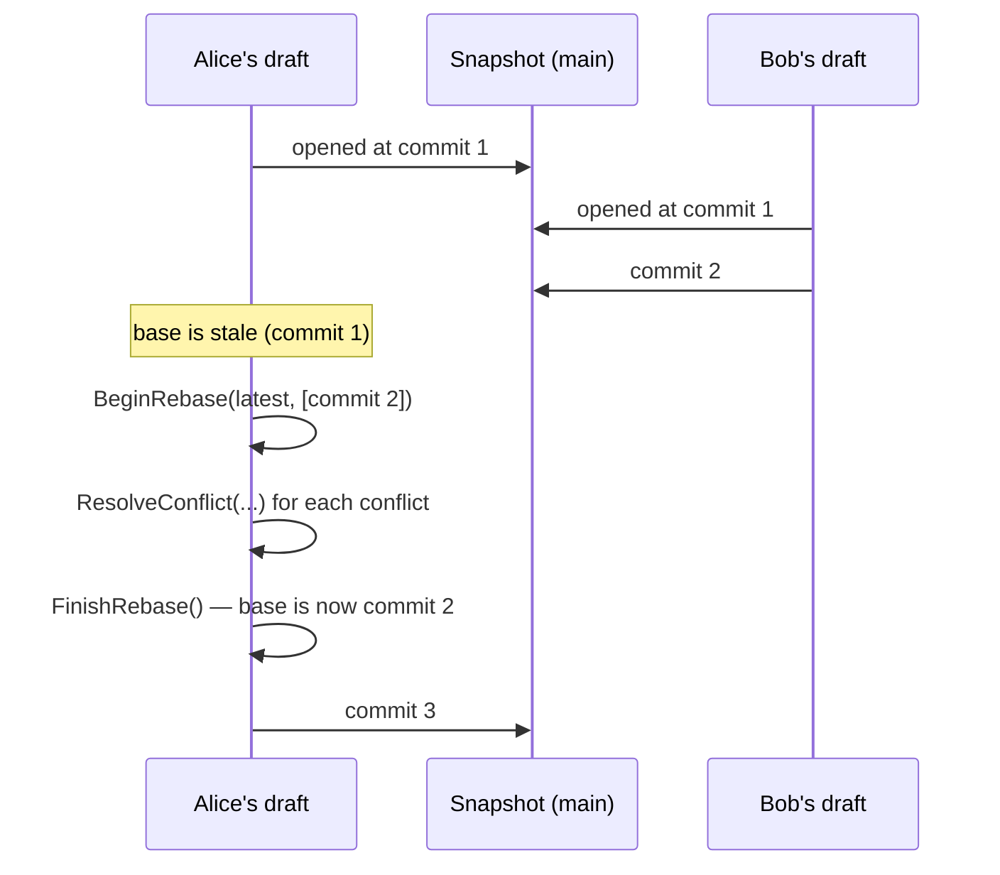

# Drafts and rebase

Each user edits in their own **overlay** — a draft over the snapshot it was opened from. Several users can hold drafts of the same aggregate at once. When another draft is committed first, a stale draft is **rebased** onto the new latest commit, with a review of what changed upstream and what conflicts with the user's own edits.



## Working with a draft

```csharp
var overlay = KVOverlay.Create(snapshot, user: "alice");
var agreement = KVRootNode.Create<Agreement>(overlay, definition);

agreement.Patch(KVPatchOperation.Set("/Title", "Renewed agreement"));

overlay.HasChanges;        // true
overlay.BaseCommitId;      // the snapshot's LastCommitId when the draft was opened
```

A draft can be persisted as just its `Changes` plus its `BaseCommitId`, and rebuilt later from the base snapshot; see [Persistence](/integration/persistence#loading-and-saving-a-draft). `KVOverlay.FromCommits(baseSnapshot, commits)` reconstructs an overlay from a sequence of commits.

Ways to drop work:

| Call | Effect |
| --- | --- |
| `root.Discard(path)` / `DISCARD` patch | Reverts one path (and everything beneath it) to the last commit. |
| `root.Clear()` | Drops every draft change (and pending domain events). |
| `overlay.Reset(target)` | Drops every change and re-bases the overlay onto `target` — "start over". |

## Committing

```csharp
var commit = agreement.CreateCommit(DateTimeOffset.UtcNow);   // validates first, throws on errors
snapshot.Apply(commit);
```

The commit carries `PreviousCommitId = overlay.BaseCommitId`. Before applying it, an application checks that the snapshot's `LastCommitId` still equals that base — if not, the draft is stale and needs a rebase (the sample API answers such a commit with `409 Conflict`). `snapshot.Apply(commit)` enforces the same rule and throws on a commit that does not continue the snapshot's chain.

## Rebasing

`BeginRebase` takes the latest snapshot and the commits made since the draft's base, oldest first:

```csharp
var outcome = overlay.BeginRebase(latestSnapshot, missingCommits);

switch (outcome)
{
    case KVRebaseOutcome.AlreadyCurrent:          // nothing to do, no rebase started
        break;
    case KVRebaseOutcome.CanAutomerge:            // only incoming changes; review is optional
        overlay.FinishRebase();
        break;
    case KVRebaseOutcome.HasUnresolvedConflicts:  // a decision is required
        foreach (var conflict in overlay.Conflicts.Where(c => c.RequiresResolution))
            overlay.ResolveConflict(conflict.Path, KVConflictResolution.Ours);
        overlay.FinishRebase();
        break;
}
```

`overlay.Conflicts` is the review list. Each `KVConflict` has a `Path`, a `Kind`, and the `BaseValue`, `MainValue` (upstream) and `OursValue` (draft); `null` means the path was absent on that side.

### Review entries

| `KVConflictKind` | Requires a decision | Meaning |
| --- | --- | --- |
| `Value` | yes | Both sides changed the same field to different values. |
| `DeleteEdit` | yes | One side deleted a path or subtree the other modified. |
| `Structural` | yes | Both sides switched a polymorphic node's `$type` to different types; resolved as a whole (Ours or Theirs, not Custom). |
| `Incoming` | no | Upstream changed something the draft did not touch. Defaults to accept. |
| `IncomingItem` | no | Upstream added or removed a collection item the draft did not touch. Defaults to accept. |

### Resolutions

| `KVConflictResolution` | For a conflict | For an incoming change |
| --- | --- | --- |
| `Ours` | keep the draft's value | reject — pin the pre-rebase value as a counter-edit |
| `Theirs` | take upstream's value | accept (the default) |
| `Custom` | use a supplied value (plain value conflicts only) | — |

`FinishRebase()` applies every resolution, swaps the overlay's base to the target and clears the rebase state; it throws while a conflict is unresolved. `CancelRebase()` aborts but keeps the draft on its original, stale base. A rebase in progress can be persisted and later restored with `RestoreRebaseState(target, conflicts)`.

### After a rebase

A rebase works on overlays without a bound aggregate, so no change reactions run during it. Bind the draft and refresh derived values before persisting it:

```csharp
overlay.FinishRebase();
var agreement = KVRootNode.Create<Agreement>(overlay, definition);
agreement.NotifyReplaced();
```
